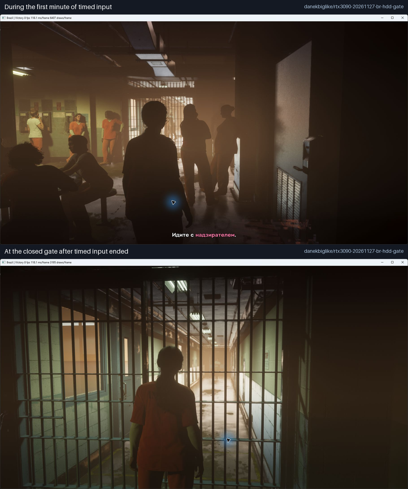

# RTX 3090 at the common-room gate on VI-BR-PORT

On 27 November 2026 a Ryzen 7 3700X and RTX 3090 rendered **1,122 presents in 120 seconds, averaging 9.35 FPS**. The player crossed the cell threshold before measurement, reached the common room and spent much of the second minute at a closed gate with forward input. The earlier [3.72 FPS escort](https://github.com/danekbiglike/leonida-rtx3090-bringup/tree/9ac81a703e6a1c072b4a2ca9c5fe80e84fe62265/reports/2026-11-26-rtx3090/texture-worker-escort) included the walk from the cell door. The different starts and time at the gate prevent a like-for-like speedup calculation.

| Sample | Presents | Mean FPS | Slowest five seconds | Five-second windows at 25 FPS or above |
| --- | ---: | ---: | ---: | ---: |
| First minute | 538 | 8.97 | 7.4 FPS | 0 of 12 |
| Second minute | 584 | 9.73 | 9.0 FPS | 0 of 12 |
| Full interval | 1,122 | 9.35 | 7.4 FPS | 0 of 24 |

The 95th-percentile present interval was 134.71 ms, the 99th percentile was 190.71 ms and the longest was 307.07 ms. The median draw count was 3,199. [Per-frame measurements](frames.csv) · [Five-second counts and memory measurements](metrics.json)

The captures were saved about 52 seconds after input started and 24 seconds after it ended. The Series X profile kept its original game settings and the BVH builder enabled. Several materials remained dark, and the walls showed rectangular lighting artifacts. During timed input, 23 performance reports recorded **418–471 omitted draw calls per frame** because a host graphics pipeline was unavailable. Between 836 and 1,060 pipelines were still being built. The rendered workload was incomplete. [Pipeline observations](pipelines.csv)

## Memory and disk activity

Process-private commit was 35.33 GiB at the start, peaked at 35.46 GiB during the timed interval and finished at 34.33 GiB. Available system commit reached a low of 1.48 GiB. A suspended build process using about 1.32 GiB of private commit was closed about 21 seconds into the measurement. The renderer completed the interval. The tester stopped the process at 14:56:22 UTC when its window did not close on request. Two minutes cannot establish long-session memory behavior.

The game read from a mechanical disk while the same package was being copied to an SSD. Across the nearest storage samples, taken at +0.90 and +118.66 seconds, the source disk averaged 12.75 MiB/s of total reads, the SSD averaged 11.76 MiB/s of writes, and the separate disk hosting the Windows page file averaged 3.50 MiB/s of reads. The counters include all host processes. This run does not measure a gain from the SSD. [Disk samples by interval](disk-io.csv)

## Reproduction

The build used [VI-BR-PORT revision 29543253](https://github.com/edsuuu/VI-BR-PORT/tree/2954325320735fa8b56a15e7f3e9654965e3462e) with [timestamped presents and input replay](escort-meter-input.patch) and [support for a game folder separate from the executable](escort-split-game-dir.patch). The renderer SHA-256 was `2f195fbc9556aafcbdf7e2408494cfb2001ac73f421053b9810af76e95af5542`. The game settings SHA-256 was `558c63ca0073281e52487c52238be017ced26837d62e49f896f00acf537a4d22`.

Use `--console series-x --execute` with the [recorded renderer environment](profile.json), a copy of the save and an isolated shader cache. The offline shader pass prepared 25,701 shaders and reported 203 unsupported. The input sequence held forward for 350 ms of each 550 ms cycle, beginning at 14:52:59.265 UTC. Presents are counted in a half-open 120-second interval on the UTC clock. [Export of the measured frames and figure](export_sample.py)

Measurement ID `danekbiglike/rtx3090-20261127-br-hdd-gate`. Local RTX 3090 benchmark and instrumentation by the danekbiglike bring-up project with ChatGPT. Renderer credit goes to VI-BR-PORT and its upstream contributors. Please cite the measurement ID and linked revision when reusing the figures or code.
