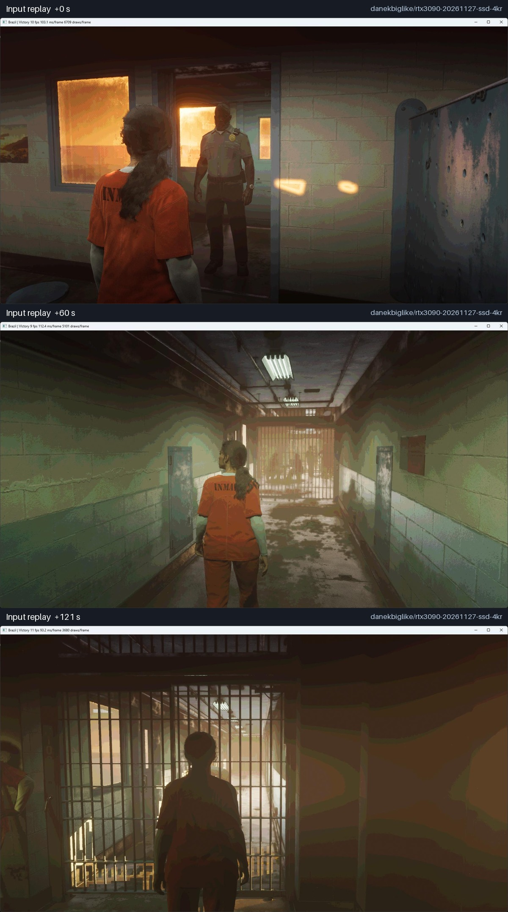

# Background texture uploads on RTX 3090 at 3840×2160

The two-minute walk from the cell door into the common room delivered 982 frames, averaging **8.18 FPS**. The slowest five-second interval averaged **4.8 FPS**. One frame took 1.718 seconds. The 95th-percentile frame interval was 203.65 ms. The earlier foreground-upload run averaged 9.07 FPS, with a minimum of 5.8 over five seconds and a 134.64 ms 95th percentile. [Frame trace](frames.csv) · [Metrics](metrics.json) · [Earlier run](https://github.com/danekbiglike/leonida-rtx3090-bringup/tree/2355c069b9b9f653b5b29ac10f8679959ac3e296/reports/2026-11-27-rtx3090/ssd-escort-4k-step0)

The launch used the Series X profile, a 3840×2160 presentation surface, native BVH building, GPU descriptor fills off, eight translation workers and `VICTORY_UPLOAD_AHEAD=1`. The log confirmed at least 60,000 early uploads totalling 2,048 MiB from launch through the end of the replay. The checkpoint is cumulative and includes the opening. The executable SHA-256 was `9b171321051cc7e5803e238c6b7efb5b71fc2b9f30bfcfca309e1e3ba1e78939`. It combines the earlier integrated release with the [allocation rollback patch](https://github.com/danekbiglike/leonida-rtx3090-bringup/tree/631bdba4435e6f51db3df7bdf07f6c577b1ef5a4/reports/2026-11-27-rtx3090/title-memory-rollback).

This run reused the prior SSD run's larger 505,760,716-byte host pipeline library. The renderer loaded that file. All 22 reports in the measured interval had zero pipelines being built at the sampling instant. Those same reports still averaged 322 to 680 omitted draws or dispatches per frame, with a median of 462. The aggregate counter covers multiple failure paths. Queue length at an instant cannot establish which path caused an omission. Rectangular lighting and missing surface detail remain visible. [Pipeline counters](pipelines.csv)

Median reported preparation time was 62.15 ms per frame. Buffer copies accounted for 34.4 ms and textures for 4.05 ms. The median GPU work was 39.25 ms. These counters can overlap. The sampled GPU utilization median was 49.5%. Private committed memory rose from 35.78 to 36.93 GiB during the walk. This test establishes that the fixed executable ran the route. It does not establish a long-session leak rate. [Frame costs](frame-costs.csv) · [GPU samples](gpu.csv)

The route timing, pipeline cache and allocation patch differed from the earlier run. This configuration missed the five-FPS minimum once in 24 five-second windows and provides no evidence of a speed or quality gain. Measurement ID `danekbiglike/rtx3090-20261127-ssd-4kr`. Local measurements by the danekbiglike bring-up project with ChatGPT. Upstream texture implementation by VI-BR-PORT and VIctory contributors.
