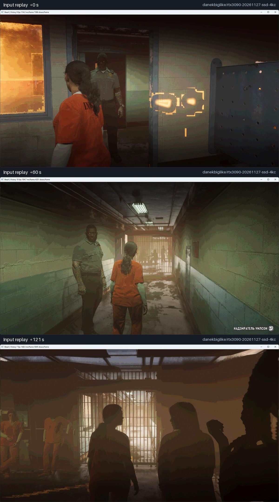

# Repeated 4K escort with allocation rollback and ordinary texture uploads

The RTX 3090 and Ryzen 7 3700X presented 800 frames in 120 seconds on the walk from the cell door to the common area. The average was **6.67 FPS**. The slowest five-second interval averaged **2.2 FPS**. There were three frame intervals over one second, with a maximum of **2.317 seconds**. The 95th-percentile interval was 315.56 ms. [Frame times](frames.csv) · [Summary](metrics.json)

| Local 4K Series X configuration | Mean FPS | Lowest five seconds, FPS | 95th percentile, ms | Longest frame, ms |
| --- | ---: | ---: | ---: | ---: |
| Integrated, ordinary uploads, GPU fills off | 9.07 | 5.8 | 134.64 | 541 |
| Integrated, ordinary uploads, GPU fills on | 10.23 | 5.4 | 155.99 | 2,204 |
| Allocation fix, background uploads, larger cache | 8.18 | 4.8 | 203.65 | 1,718 |
| Allocation fix, ordinary uploads, original cache | 6.67 | 2.2 | 315.56 | 2,317 |

The first run delivered the shortest observed tail latency. The GPU-fills run spent longer at the gate. The background-upload run used a larger cache and completed most pipeline compilation earlier. The first and last runs used the same source cache, cloned settings, Series X profile, SSD and timed forward input. The last run drew a median of 5,518 calls per frame and had 322 to 897 pipelines in the build queue at its reporting instants. The tests were single route replays, so differences in timings do not isolate the cost of the allocation change. [First replay](https://github.com/danekbiglike/leonida-rtx3090-bringup/tree/2355c069b9b9f653b5b29ac10f8679959ac3e296/reports/2026-11-27-rtx3090/ssd-escort-4k-step0) · [GPU fills](https://github.com/danekbiglike/leonida-rtx3090-bringup/tree/e22d5001fd2da93afde030e1fa957d84e8eac4d8/reports/2026-11-27-rtx3090/ssd-escort-4k-step1) · [Background textures](https://github.com/danekbiglike/leonida-rtx3090-bringup/tree/df4e2a96c08f93601de1fbd2e0ed0833c65dd155/reports/2026-11-27-rtx3090/ssd-4k-background-textures)

The estimated median preparation cost was 74.8 ms per frame. Buffer copies accounted for 35.2 ms and textures for 1.8 ms. Median GPU time was 39.0 ms and sampled GPU utilization was 49%. These timing counters can overlap. The renderer counted a median 468.5 omissions per frame across its 22 reporting windows. Private committed memory rose from 37.19 to 37.79 GiB. Available system commit fell to 1.93 GiB. This run ended by operator request after recording the replay. [Frame costs](frame-costs.csv) · [GPU](gpu.csv) · [Omissions](pipelines.csv)

Executable SHA-256 `9b171321051cc7e5803e238c6b7efb5b71fc2b9f30bfcfca309e1e3ba1e78939`. Measurement ID `danekbiglike/rtx3090-20261127-ssd-4kc`. Local measurement by the danekbiglike bring-up project with ChatGPT. Renderer credit goes to VI-BR-PORT and VIctory contributors.
