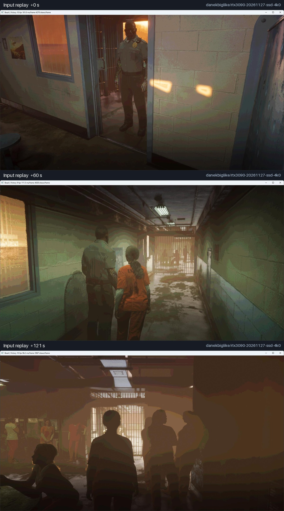

# RTX 3090 Series X escort from the cell door on SSD

The integrated renderer presented **1,088 frames in 120 seconds, averaging 9.07 FPS**. The first minute averaged 8.65 FPS and the second 9.48. All 24 five-second windows exceeded 5 FPS. The slowest window averaged 5.8 FPS, and none reached 25. The 95th-percentile interval was 134.64 ms, with a longest interval of 541.42 ms. [Frames](frames.csv) · [Summary](metrics.json)

The captured run began at the open cell door facing the officer. Lucia followed the officer down the corridor into the common area. The renderer used the Series X profile, a 3840×2160 presentation surface, native BVH building, eight command translation workers, AVX2 relay merging and `VICTORY_CARD_STEPS=0`. The setup used the same archived save and settings as the earlier controls. The input held forward for 350 ms in each 550 ms period. [Integrated build and patches](https://github.com/danekbiglike/leonida-rtx3090-bringup/tree/00ee6ff54e400e1391419abc9e070467dbcb346a/reports/2026-11-27-rtx3090/integrated-release)

The RTX 3090 and Ryzen 7 3700X read the verified 208.51 GiB package from the SSD. The offline driver warmup processed 1,967 previously used pipelines, including one the host could not create. The cache still left a median of 462 omitted draw calls per frame across 23 reporting windows, spanning 306 to 539. Rectangular lighting artifacts remain visible. The GPU utilization median was 54.5% and peak sampled VRAM usage was 18,339 MiB. [Pipeline observations](pipelines.csv) · [GPU samples](gpu.csv)

Private committed memory increased from 35.11 to 36.07 GiB during the timed interval. Available system commit stayed above 4.63 GiB. This run was stopped by the tester after the replay and end capture. The two-minute difference does not establish a long-session leak rate.

The previous HDD gate sample used a different renderer, starting position and workload. The earlier 3.72 FPS escort also used a different renderer. These comparisons cannot isolate an SSD performance effect. [HDD gate](https://github.com/danekbiglike/leonida-rtx3090-bringup/tree/51e8103f47f39b5aeb6793c2cd2f5965e5b48efe/reports/2026-11-27-rtx3090/br-hdd-gate) · [Earlier escort](https://github.com/danekbiglike/leonida-rtx3090-bringup/tree/9ac81a703e6a1c072b4a2ca9c5fe80e84fe62265/reports/2026-11-26-rtx3090/texture-worker-escort)

Measurement ID `danekbiglike/rtx3090-20261127-ssd-4k0`. Local measurements by the danekbiglike bring-up project with ChatGPT. Renderer credit goes to VI-BR-PORT and its upstream contributors.
