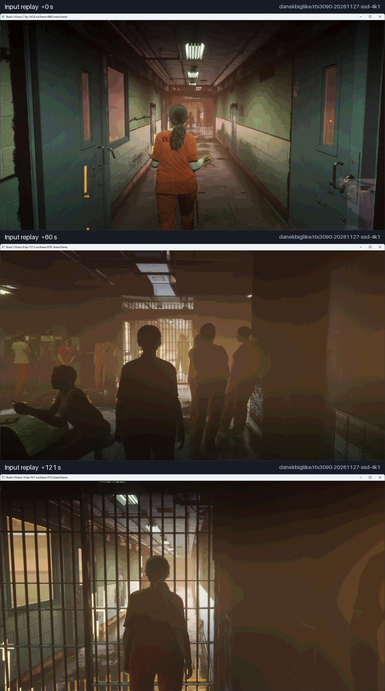

# GPU descriptor fills in the prison corridor on RTX 3090

With GPU descriptor fills enabled, the renderer presented 1,228 frames in 120 seconds at 3840×2160 on the Series X profile. The mean was 10.23 FPS. The slowest five-second window averaged 5.4 FPS and none of the 24 windows reached 25 FPS. Two frames took over one second. The longest took 2.204 seconds, 8.54 seconds into the test. [Frames](frames.csv) · [Summary](metrics.json)

| Two-minute input replay | GPU fills off | GPU fills on |
| --- | ---: | ---: |
| Mean FPS | 9.07 | 10.23 |
| Slowest five seconds, FPS | 5.8 | 5.4 |
| 95th-percentile frame interval, ms | 134.64 | 155.99 |
| Longest frame, ms | 541.42 | 2,204.14 |
| Intervals over 200 ms | 18 | 32 |
| Median draw calls per frame | 5,190.5 | 4,349.5 |
| Median reported omitted draw calls per frame | 462 | 464 |

Both runs used the same executable, SSD game data, source cache, save, GPU and two-minute forward input. They reached different positions. With GPU fills enabled the timer began inside the corridor, the common area was visible by 60 seconds, and Lucia was at the gate at both 90 and 121 seconds. The first run began at the cell door and was still following the officer at 90 seconds. The mean FPS difference includes the effect of this change of scene. The first run delivered more consistent frame times in the observed samples. [First run](https://github.com/danekbiglike/leonida-rtx3090-bringup/tree/2355c069b9b9f653b5b29ac10f8679959ac3e296/reports/2026-11-27-rtx3090/ssd-escort-4k-step0)

The GPU utilization median was 54%, and peak sampled VRAM usage was 20,747 MiB. Private committed memory started at 40.19 GiB and ended at 40.05 GiB. System commit headroom fell to 0.65 GiB. The renderer reported 435 to 510 omitted draw calls per frame across 22 windows. The tester closed the process after recording the end position. [GPU](gpu.csv) · [Pipeline counts](pipelines.csv)

Measurement ID `danekbiglike/rtx3090-20261127-ssd-4k1`. Local measurements by the danekbiglike bring-up project with ChatGPT. Renderer credit goes to VI-BR-PORT and its upstream contributors.
